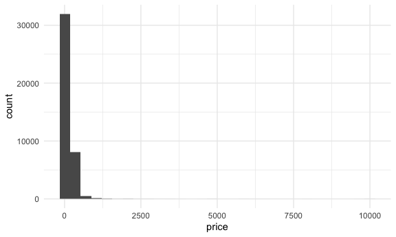
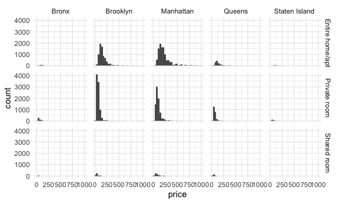
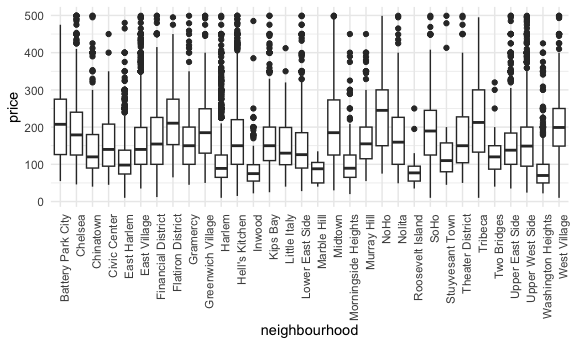

case_study
================
Emma
2026-10-13

What is data science? Revisited.

- you need data skils most of the time
- but also intellectual curiosity, problem solving, collaboration

# Some questions to answer with this dataset

- where are the most expensive airbnbs in nyc?
- which neighborhood has the highest concentration of airbnbs?
- which one is the cheapest?
- which airbnb hosts are the most/best reviewed?
- has the number of airbnbs increased or decreased over time?
- do airbnbs affect rent in their neighborhoods?
- do descriptions correlate with price?
- what about text reviews?

``` r
nyc_airbnb = 
  nyc_airbnb |>  
  mutate(stars = review_scores_location / 2)
```

``` r
nyc_airbnb |> 
  count(room_type, neighbourhood_group) |> 
  pivot_wider(
    names_from = room_type, 
    values_from = n
  )
```

    ## # A tibble: 5 × 4
    ##   neighbourhood_group `Entire home/apt` `Private room` `Shared room`
    ##   <chr>                           <int>          <int>         <int>
    ## 1 Bronx                             192            429            28
    ## 2 Brooklyn                         7427           9000           383
    ## 3 Manhattan                       10814           7812           586
    ## 4 Queens                           1388           2241           192
    ## 5 Staten Island                     116            144             1

``` r
nyc_airbnb |> 
  filter(neighbourhood_group == "Manhattan") |> 
  count(room_type, neighbourhood) |> 
  pivot_wider(
    names_from = room_type, 
    values_from = n
  )
```

    ## # A tibble: 32 × 4
    ##    neighbourhood      `Entire home/apt` `Private room` `Shared room`
    ##    <chr>                          <int>          <int>         <int>
    ##  1 Battery Park City                 44             19             2
    ##  2 Chelsea                          774            274            24
    ##  3 Chinatown                        195            164             1
    ##  4 Civic Center                      25             17            NA
    ##  5 East Harlem                      433            558            57
    ##  6 East Village                    1093            742            23
    ##  7 Financial District               229            145            17
    ##  8 Flatiron District                 77             12             1
    ##  9 Gramercy                         185            116             6
    ## 10 Greenwich Village                287             93             3
    ## # ℹ 22 more rows

Maybe remove shared rooms from analyses? there are not that many. Pivot
wider just to make it easier for me to read

# Price

Least expensive

``` r
nyc_airbnb |> 
  mutate(price_rank = min_rank(price)) |> 
  filter(price_rank < 3) |> view()
```

Most expensive

``` r
nyc_airbnb |> 
  group_by(neighbourhood_group) |> 
  mutate(price_rank = min_rank(desc(price))) |> 
  filter(price_rank < 2) |> 
  view()
```

Plot it

``` r
nyc_airbnb |> 
  ggplot(aes(x = price)) +
  geom_histogram() 
```

    ## `stat_bin()` using `bins = 30`. Pick better value `binwidth`.



Where are most air bnbs? what happens to the price distribution in each
borough?

``` r
nyc_airbnb |> 
  filter(price < 1000) |> 
  ggplot(aes(x = price)) +
  geom_histogram() +
  facet_grid(room_type ~ neighbourhood_group)
```

    ## `stat_bin()` using `bins = 30`. Pick better value `binwidth`.



Prices on average - use median because of outliers

``` r
nyc_airbnb |>  
  group_by(room_type, neighbourhood_group) |> 
  summarize(
    median_price = median(price)
  ) |> 
  pivot_wider(
    names_from = room_type, 
    values_from = median_price
  )
```

    ## `summarise()` has regrouped the output.
    ## ℹ Summaries were computed grouped by room_type and neighbourhood_group.
    ## ℹ Output is grouped by room_type.
    ## ℹ Use `summarise(.groups = "drop_last")` to silence this message.
    ## ℹ Use `summarise(.by = c(room_type, neighbourhood_group))` for per-operation
    ##   grouping (`?dplyr::dplyr_by`) instead.

    ## # A tibble: 5 × 4
    ##   neighbourhood_group `Entire home/apt` `Private room` `Shared room`
    ##   <chr>                           <dbl>          <dbl>         <dbl>
    ## 1 Bronx                            100              55            43
    ## 2 Brooklyn                         145              65            40
    ## 3 Manhattan                        190              90            65
    ## 4 Queens                           119              60            39
    ## 5 Staten Island                    112.             55            25

Visualizing price distribution in neighborhoods in manhattan

``` r
nyc_airbnb |> 
  filter(neighbourhood_group == "Manhattan") |> 
  filter(price < 500) |> 
  ggplot(aes(x = neighbourhood, y = price)) +
  geom_boxplot() +
  theme(axis.text.x = element_text(angle = 90, hjust =1))
```


turning axis labels 90 degrees

Most/best reviewed hosts

``` r
nyc_airbnb |> 
  filter(calculated_host_listings_count > 10)
```

    ## # A tibble: 343 × 18
    ##          id review_scores_location name    host_id host_name neighbourhood_group
    ##       <dbl>                  <dbl> <chr>     <dbl> <chr>     <chr>              
    ##  1 13631870                      9 DRIFTE… 8874674 Laura     Queens             
    ##  2 13316222                      9 DRIFTE… 8874674 Laura     Queens             
    ##  3 13316290                      9 DRIFTE… 8874674 Laura     Queens             
    ##  4 13316073                      9 DRIFTE… 8874674 Laura     Queens             
    ##  5 15800729                      6 DRIFTE… 8874674 Laura     Queens             
    ##  6 16601447                      8 DRIFTE… 8874674 Laura     Queens             
    ##  7 16601611                      9 DRIFTE… 8874674 Laura     Queens             
    ##  8 16601720                     NA DRIFTE… 8874674 Laura     Queens             
    ##  9 16601901                     10 DRIFTE… 8874674 Laura     Queens             
    ## 10 13332509                      9 DRIFTE… 8874674 Laura     Queens             
    ## # ℹ 333 more rows
    ## # ℹ 12 more variables: neighbourhood <chr>, lat <dbl>, long <dbl>,
    ## #   room_type <chr>, price <dbl>, minimum_nights <dbl>,
    ## #   number_of_reviews <dbl>, last_review <date>, reviews_per_month <dbl>,
    ## #   calculated_host_listings_count <dbl>, availability_365 <dbl>, stars <dbl>
